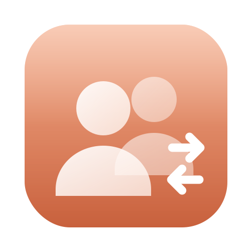

<p align="center">
  
</p>

<h1 align="center">Clatch</h1>

<p align="center">
  <b>Switch between Claude Desktop accounts from the menu bar (macOS) or the notification area (Windows).</b><br>
  One click or one shortcut. No signing out and back in again.
</p>

<p align="center">
  <sub>By <a href="https://issen.kurokamicorp.com/"><b>Issen Software Group</b></a></sub>
</p>

<p align="center">
  <a href="https://www.paypal.com/donate/?business=juanesgtgt2%40gmail.com&no_recurring=0&item_name=Issen+Software+Group">
    
  </a>
  
</p>

---

## What it does

The Claude Desktop app holds one sign-in at a time. If you have a work account and a personal
one, switching means signing out, signing in again and waiting for the second sign-in email.

Clatch keeps each account's sign-in on your Mac and swaps between them for you. Every account keeps
its own sign-in and its own local data.

- **macOS**: Apple silicon and Intel, **macOS 11 Big Sur** (the first macOS for M1) through
  macOS 27. **Liquid Glass** on macOS 26 and later, a matching translucent look before.
  Lives in the **menu bar** only, no Dock icon.
- **Windows**: x64 and ARM64, **Windows 10 (1809) and 11**. A WinUI 3 app with **Acrylic**.
  Lives in the **notification area** only, no taskbar button.
- **Global shortcut**: **⌃⌥⌘C** on macOS, **Ctrl+Alt+Win+C** on Windows, switches to the next
  account from anywhere. You can change it.
- **Closes Claude the polite way.** If a local session is running, Claude asks you before quitting,
  and Clatch waits for your answer.
- **Very light.** While its panel is closed, Clatch draws nothing and runs nothing. It's just an
  icon and a shortcut.
- **Fail-safe.** Before moving anything, Clatch checks that Claude's data folder still looks the way
  it expects. If Claude has changed how it stores its data, Clatch stops, tells you what's
  different and asks whether to continue anyway.
- **Nothing to sign in to.** Clatch never reads, stores or sends your credentials. It only moves
  folders on your own Mac.

---

## Install

### macOS

1. Download the latest **Clatch .dmg** from the
   [Releases page](https://github.com/AA-EION/Clatch/releases).
2. Open it and drag **Clatch** into **Applications**.
3. Open Clatch from your Applications folder. Its icon (two people) appears in the menu bar.

> **Test builds (marked "Pre-release")** aren't signed by Apple yet, so macOS will refuse to
> open them the first time. After copying the app to Applications, go to
> **System Settings › Privacy & Security** and click **Open Anyway** (on macOS 14 and older:
> right-click Clatch › **Open**). You can also run this in Terminal instead:
> `xattr -dr com.apple.quarantine /Applications/Clatch.app`

### Windows

1. Download **Clatch-…-windows-setup.exe** from the
   [Releases page](https://github.com/AA-EION/Clatch/releases) and run it. It installs for your
   user only, so no administrator password is needed. The same installer works on x64 and ARM64 PCs.
2. Clatch starts and its icon appears in the **notification area** next to the clock. (If you don't
   see it, click the **^** arrow; you can drag the icon out to keep it visible.)

> **Test builds** aren't code-signed yet, so SmartScreen may say "Windows protected your PC".
> Click **More info › Run anyway**.

### Updating

Quit Clatch (menu bar icon › **Quit Clatch**), download the new .dmg and replace the app in
Applications. Your accounts stay as they are.

### Uninstalling

1. In Clatch, switch to the account you want to keep using in Claude.
2. **macOS**: quit Clatch and drag it to the Trash. **Windows**: *Settings › Apps › Installed apps ›
   Clatch › Uninstall*.
3. Optional: delete Clatch's folder, which holds the other accounts' saved sign-ins
   (**Settings › Show Accounts Folder** opens it): `~/Library/Application Support/Clatch` on macOS,
   `%LOCALAPPDATA%\Clatch` on Windows.

---

## Using it

### Adding your second account

At first Clatch knows one account: the one signed in to Claude right now ("Account 1").

1. Click the Clatch icon (menu bar on macOS, notification area on Windows), then
   **Add Another Account…**.
2. Give both accounts a name (your email address works well), then click **Quit Claude & Add**.
3. Claude quits. If a local session is running, Claude asks whether to quit; choose **Quit**.
   (If you choose **Cancel**, nothing changes: click **Ask Claude Again** or **Cancel** in Clatch.)
4. Clatch puts your first account's data aside and opens Claude fresh. Sign in with the other
   account.

That's it. Both accounts now show up in the Clatch menu.

### Switching

- **Click** an account in the Clatch menu, or
- press **⌃⌥⌘C** (macOS) or **Ctrl+Alt+Win+C** (Windows) anywhere to switch to the next account
  (it goes round the list).

Clatch asks Claude to quit, waits until Claude and all its background processes have closed, swaps
the accounts and opens Claude again. Usually that takes a couple of seconds.

On Windows, Claude is asked to close the same way Windows asks apps to close when it shuts down,
so Claude can still ask you first. If it doesn't close, quit it from its own notification area
icon; Clatch carries on by itself.

### If Claude's data looks different

Clatch depends on how Claude Desktop stores its data, and Anthropic can change that in any update.
Before every switch Clatch checks that Claude's data folder is where it expects and contains what
it expects. If not, the switch stops *before anything is moved* and Clatch shows:

- what is different (for example "the data folder was not found", or "no longer contains
  config.json"), and any other folder where Claude may now keep its data;
- **Cancel**, which leaves everything as it is and reopens Claude, or **Continue Anyway**.

Continuing is not dangerous: Clatch only ever renames folders and never deletes anything. At worst
Claude starts signed out, or the switch has no effect. If you see this warning, please
[open an issue](https://github.com/AA-EION/Clatch/issues) so Clatch can be updated.

The **⋯** button next to each account lets you rename it, reorder it or remove it.

### Settings

| Setting | What it does |
|---|---|
| **Switch to next account** | The global shortcut. Click **Change** and type a new one, **Default** for ⌃⌥⌘C, or **✕** to turn it off. |
| **Reopen Claude after switching** | On by default. Off: Claude stays closed after a switch until you open it. |
| **Same MCP & tool settings for every account** | On by default. Your `claude_desktop_config.json` (MCP servers and other tools) follows you to every account. |
| **Open Clatch at login** | Start Clatch when you log in. macOS 13 and later (on older versions add it in *System Preferences › Users & Groups › Login Items*); always available on Windows. |
| **Show Accounts Folder** | Opens the folder where Clatch keeps the accounts that aren't active. |

### Why ⌃⌥⌘C and Ctrl+Alt+Win+C?

The default shortcut has to be something nothing else uses. macOS and mainstream apps leave
**Control-Option-Command** combinations free. The few system shortcuts with all three (⌃⌥⌘8,
⌃⌥⌘, and ⌃⌥⌘. for accessibility, ⌃⌥⌘⏏ to shut down) don't involve **C**, and Claude Desktop's own
shortcut is ⌥Space. C is for Claude.

On Windows, **Ctrl+Alt** alone is the **AltGr** key on many keyboard layouts (AltGr+C types "ć" on
Polish keyboards), and most **Win+letter** shortcuts are reserved by Windows. All three together,
Ctrl+Alt+Win+C, are free. On both systems, if another app already uses the shortcut, Clatch tells
you and you can pick another one.

---

## Troubleshooting

| Problem | What to try |
|---|---|
| **Clatch keeps "Waiting for Claude to quit/close"** | Claude may be showing a "quit?" dialog behind other windows. Answer it, or click **Cancel** in Clatch. On Windows you can also quit Claude from its notification area icon. |
| **"Claude's data looks different"** | Claude may have changed how it stores data. See [above](#if-claudes-data-looks-different). |
| **"Waiting for Claude to finish" doesn't end** | A Claude background process is still running. Wait a moment. On macOS, **Switch Anyway** is safe (see [How it works](docs/HOW-IT-WORKS.md)); on Windows Clatch has to wait, because Windows can't move a folder whose files are in use. |
| **The shortcut does nothing** | Another app may own it. Open **Settings**; Clatch shows a warning if the shortcut is taken. Pick another one. |
| **Claude shows the wrong account** | Make sure you only switch with Clatch, not by signing out inside Claude. If you signed out, sign in again; the account in Clatch is simply refreshed. |
| **Anything else** | Open an [issue](https://github.com/AA-EION/Clatch/issues). |

---

## Common questions

**Does Claude Desktop support several accounts by itself?**
Not at the moment. It keeps one sign-in, which is why Clatch exists.

**Can I use two accounts at the same time?**
No. Clatch switches the one Claude app between accounts. That keeps Claude itself untouched, so
updates and local sessions keep working as usual.

**Is my data safe?**
Clatch never opens your sign-in data. It renames folders on your own disk, and it only does so
once Claude is completely closed. Nothing is deleted. Removing an account in Clatch moves its
data to the Trash.

**Does it affect Claude Code in the terminal?**
No. Clatch only switches the **Claude Desktop** app. The `claude` command-line tool keeps its own
sign-in.

**Does it need special permissions?**
No. No accessibility access, no input monitoring, no administrator password. The shortcut uses the
system's standard hot key service, which only tells Clatch when *its* shortcut is pressed.

---

## How it works (short version)

On macOS:

```
~/Library/Application Support/
├── Claude/                        ← what Claude Desktop uses: the active account
└── Clatch/
    ├── accounts.json              ← names and order of your accounts
    └── Accounts/
        └── <account id>/Claude/   ← each other account, waiting its turn
```

On Windows the same layout lives in `%APPDATA%\Claude` (classic installer) or
`%LOCALAPPDATA%\Packages\Claude_…\LocalCache\Roaming\Claude` (Microsoft Store/MSIX install), with
Clatch's folder in `%LOCALAPPDATA%\Clatch`.

Claude Desktop keeps everything that makes up a sign-in (cookies, local storage, encrypted
tokens) in `~/Library/Application Support/Claude`. Switching moves that folder aside and moves
the other account's folder in. Both moves are instant renames on the same disk, recorded in a
journal first, so even a power cut halfway through gets finished the next time Clatch starts.

More detail: [docs/HOW-IT-WORKS.md](docs/HOW-IT-WORKS.md)

---

## For developers

### Building for macOS

You need **Xcode 26** or later (Swift 6.2 and the macOS 26 SDK). The app still runs on macOS 11.

```bash
swift test                    # unit tests
./scripts/build-app.sh        # → dist/Clatch.app (universal arm64 + x86_64)
./scripts/make-dmg.sh         # → dist/Clatch-<version>.dmg
open dist/Clatch.app
```

Local builds are signed ad hoc. To sign with your own certificate:

```bash
export CLATCH_SIGN_IDENTITY="Developer ID Application: Your Name (TEAMID)"
./scripts/build-app.sh && ./scripts/make-dmg.sh
```

### Building for Windows

You need the **.NET 10 SDK**, Visual Studio 2022 or later with the C++ build tools for x64 and ARM64
(NativeAOT), and **Inno Setup 6.3+** for the installer.

```powershell
dotnet test windows/tests/Clatch.Core.Tests    # unit tests (also run on macOS and Linux)
pwsh windows/scripts/build.ps1                 # → windows/out/Clatch-<version>-windows-setup.exe
```

### Layout

| Path | What's there |
|---|---|
| `Sources/ClatchCore` | Accounts, folder switching with journal and recovery, process scanning. No UI; unit-tested. |
| `Sources/Clatch` | The menu bar app: AppKit status item and popover, SwiftUI panel, Carbon hot key. |
| `Tests/ClatchCoreTests` | Switching, recovery after a crash, shared settings, shortcut rules. |
| `scripts/` | App bundle, DMG, icon and DMG background rendering, CI signing. |
| `windows/src/Clatch.Core` | The same engine in C#: accounts, journaled switching, fail-safe. No Windows APIs; unit-tested. |
| `windows/src/Clatch` | The Windows app: WinUI 3 flyout, notification area icon, hot key, Restart Manager, Claude detection. |
| `windows/installer` | Inno Setup script: one per-user installer for x64 and ARM64. |
| `.github/workflows` | CI on Apple silicon, Intel and Windows; releases (DMG + Windows installer) from `v*` tags. |

### Releasing

`VERSION` holds the version for both platforms. Bump it, then push a tag. A tag with a suffix publishes a prerelease:

```bash
git tag -a v0.1.0-beta.1 -m "Clatch 0.1.0 beta 1" && git push origin v0.1.0-beta.1
```

Stable tags need the signing and notarization secrets listed in
[`.github/workflows/release.yml`](.github/workflows/release.yml).

---

## Support & Donations

Clatch is free and open-source software. If it has been helpful to you, consider supporting its ongoing development:

<p align="center">
  <a href="https://www.paypal.com/donate/?business=juanesgtgt2%40gmail.com&no_recurring=0&item_name=Issen+Software+Group">
    
  </a>
</p>

* **PayPal**: [Donate via PayPal](https://www.paypal.com/donate/?business=juanesgtgt2%40gmail.com&no_recurring=0&item_name=Issen+Software+Group)
* **PayPal Email**: `juanesgtgt2@gmail.com`

The **Donate** item at the bottom of the Clatch menu opens the same page.

---

## License

Copyright © 2026 Issen Software Group.

Clatch is free software: you can redistribute it and/or modify it under the terms of the
**GNU General Public License as published by the Free Software Foundation, either version 3 of
the License, or (at your option) any later version** (GPL-3.0-or-later). See [LICENSE](LICENSE).

Clatch is distributed in the hope that it will be useful, but WITHOUT ANY WARRANTY; without even
the implied warranty of MERCHANTABILITY or FITNESS FOR A PARTICULAR PURPOSE.

Clatch is an independent project. It is not made by, affiliated with or endorsed by Anthropic.
"Claude" is a trademark of Anthropic, PBC.
